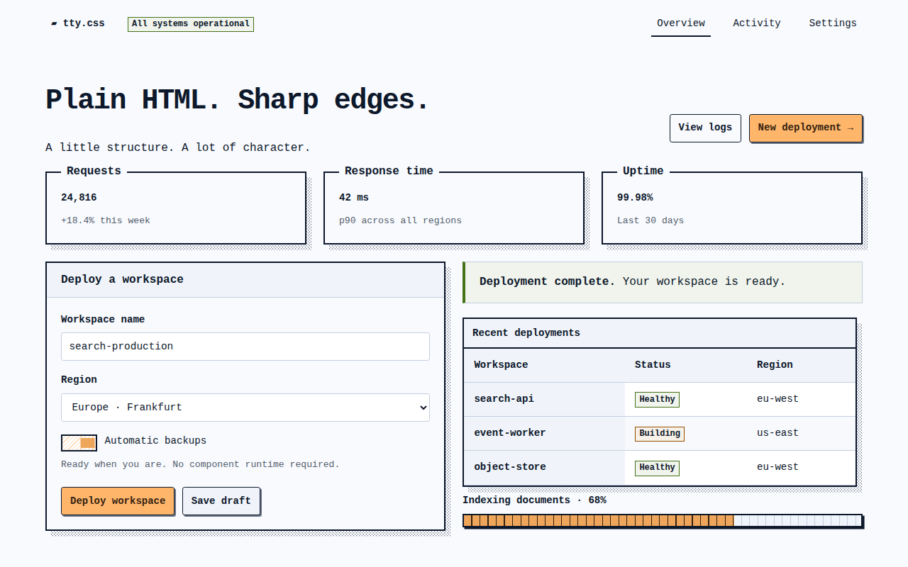

# tty.css

A small, class-light CSS framework for semantic HTML. Monospace text, sharp borders,
and textured shadows. **One CSS file. No framework JavaScript.**

## Documentation

Visit the [documentation](https://slok.github.io/tty.css/docs/reference/) to get started.
Explore the [examples](https://slok.github.io/tty.css/docs/examples/) or
[make the theme your own](https://slok.github.io/tty.css/docs/reference/colors.html).

## License

[MIT](LICENSE) © slok
